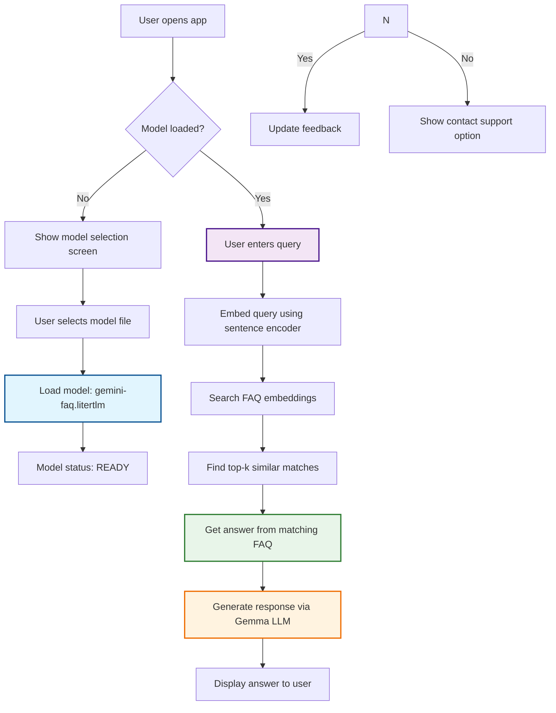

# Customer_FAQ_Chatbot

Project Overview
================

Customer_FAQ_Chatbot is an Android-powered chatbot application designed to provide automated customer support for Banglalink services. The bot leverages large language models (LLM) and semantic search through FAQ embeddings to answer customer queries based on verified FAQ data.

Architecture
------------

The project follows a modern Android architecture pattern with the following key components:

UI Layer (Compose)
------------------

- Built using Jetpack Compose for a responsive, modern UI
- MainActivity - Main entry point with model selection and chat interface
- MessageBubble - Composables for displaying user and bot messages
- Scaffold - Material Design 3 layout structure

Data Layer
----------

- FaqRepository - Loads and manages FAQ data from JSON assets
- FaqEntry - Data class representing a FAQ entry with id, category, question, answer, keywords, and source
- FaqRetriever - Uses embedding-based semantic search to find relevant FAQ answers
  - Converts questions/answers to vector embeddings
  - Performs cosine similarity search against indexed FAQ entries
  - Returns top-k most similar matches

Model Layer
-----------

- Gemma model (Google's lightweight LLM) - Runs locally using LitertLM runtime
- Model files stored in assets/models/customer-faq/
- On-demand model loading via file picker

Flow Diagram
------------



Use Methodology
---------------

### 1. User Interaction Flow

1. User launches the application
2. Model loads automatically (or user selects via file picker)
3. User types a question in the chat input
4. System embeds the query using Universal Sentence Encoder
5. FAQ retrieval system searches for semantically similar questions
6. Top matching FAQ answers are fetched
7. Gemma LLM generates a refined response based on the FAQ answer
8. Response displayed to user with source attribution

### 2. FAQ Search Process

```
Input: User query string
1. Normalize and trim query
2. Generate embedding vector using embedQuery()
3. Compute cosine similarity against all indexed FAQ entries
4. Filter by minimum similarity threshold (default: 0.35)
5. Sort by similarity score (descending)
6. Return top N results (default: 3)
```

### 3. Model Management

- Models are stored as `.litertlm` files in the assets folder
- Model switching is supported via the file chooser
- Retry mechanism available for failed model loading
- Model caching and status checking

Technology Stack
----------------

- **Language**: Kotlin
- **UI Framework**: Jetpack Compose (Material Design 3)
- **LLM Runtime**: Google LitertLM (Gemma model)
- **Embedding**: Universal Sentence Encoder (TensorFlow Lite)
- **JSON Parsing**: org.json
- **Build System**: Gradle with Kotlin DSL

Project Structure
-----------------

```
Customer_FAQ_Chatbot/
├── gradle/                    # Gradle wrapper
├── build/                     # Build outputs
├── app/
│   ├── src/
│   │   └── main/
│   │       ├── java/
│   │       │   └── com/example/customer_faq_chatbot/
│   │       │       ├── MainActivity.kt    # Main entry point
│   │       │       ├── FaqRepository.kt   # FAQ data loading
│   │       │       ├── FaqRetriever.kt    # Semantic search
│   │       │       └── ui/
│   │       │           └── theme/
│   │               ├── Color.kt           # Color palette
│   │               ├── Type.kt            # Typography styles
│   │               └── Theme.kt           # Compose theme
│   │       ├── res/                       # Resources
│   │       ├── AndroidManifest.xml      # App configuration
│   │       └── assets/
│   │           ├── faq.json             # FAQ data
│   │           ├── models/
│   │           │   └── gemini-faq.litertlm
│   │           └── universal_sentence_encoder.tflite
│   ├── build.gradle.kts                 # Module build config
│   └── ...
├── settings.gradle.kts                  # Project configuration
├── build.gradle.kts                     # Top-level build config
└── gradle.properties                  # Gradle settings
```

FAQ Data Format
---------------

The `faq.json` asset file should contain a JSON array of FAQ entries:

```json
[
  {
    "id": "unique-id-1",
    "category": "Billing",
    "question": "How do I recharge my balance?",
    "answer": "You can recharge using...",
    "keywords": ["recharge", "balance", "top-up"],
    "source": "FAQ-001"
  },
  {
    "id": "unique-id-2",
    "category": "Technical",
    "question": "Why is my internet slow?",
    "answer": "Slow internet can be caused by...",
    "keywords": ["internet", "slow", "connection"],
    "source": "FAQ-002"
  }
]
```

Getting Started
---------------

1. **Prerequisites**: Android Studio Arctic Fox or newer
2. **Setup**: Open the project in Android Studio
3. **Model**: Place the `.litertlm` model file in `app/src/main/assets/models/customer-faq/`
4. **FAQ Data**: Ensure `faq.json` is in `app/src/main/assets/`
5. **Build**: Connect an Android device or use emulator
6. **Run**: Click "Run" in Android Studio

## Contact

For support or questions about this project, please refer to the documentation or contact the development team.